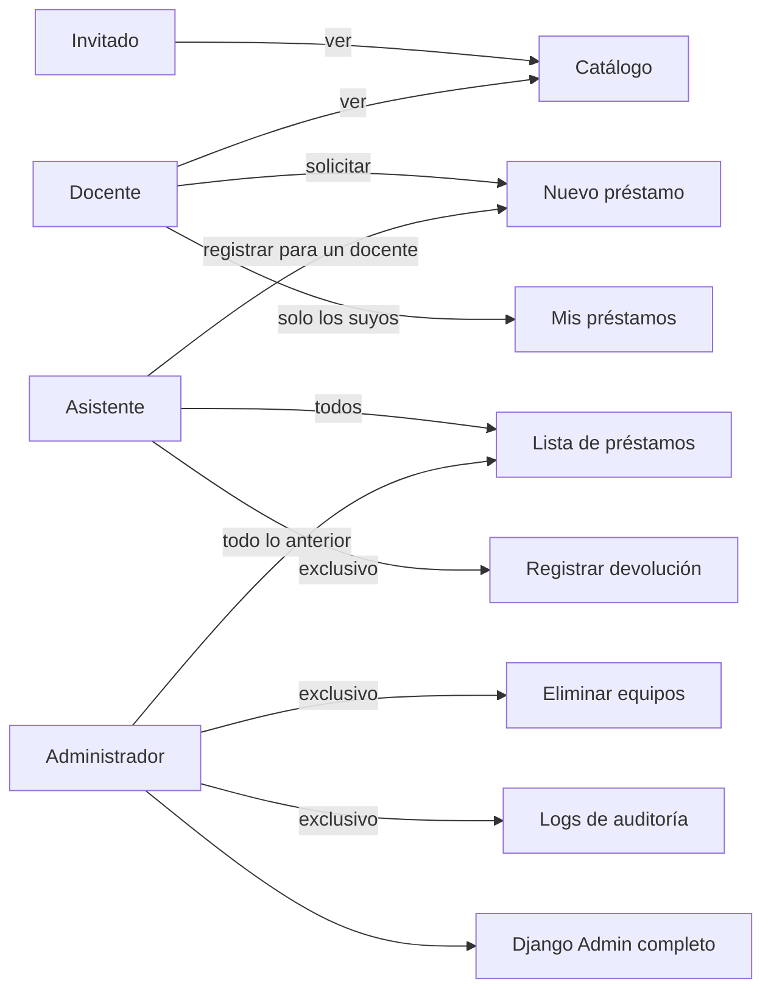

# Sistema de Gestión de Préstamos de Equipos de Laboratorio

Caso 1 de la Práctica Grupal de la Semana 12 de Desarrollo de Aplicaciones Web (IS093A), Universidad Nacional del Centro del Perú. El sistema digitaliza el préstamo de equipos de los laboratorios de la Facultad de Ingeniería de Sistemas, desde la solicitud hasta la devolución, con control de acceso por roles y auditoría.

## Integrantes

| Integrante | Rama | Responsabilidades |
|---|---|---|
| Torres Ambrosio, Katherine Medally | `dev/integrante-1` | Modelos, formularios, validaciones `clean()`/`clean_<campo>()`, Django Admin, plantillas |
| Ramos Tacza, Camilda | `dev/integrante-2` | Settings, middleware de auditoría, autenticación, roles y permisos, sesiones |


## Usuarios de prueba

Contraseña de todos los usuarios: `Uncp2026!` (se guarda hasheada con PBKDF2-SHA256).

| Usuario | Rol | Qué puede hacer |
|---|---|---|
| `jefe_lab` | Administrador | Todo: CRUD de equipos y laboratorios, eliminar equipos, ver logs de auditoría |
| `asistente1` | Asistente | Registrar préstamos para cualquier docente y registrar devoluciones |
| `jperez` | Docente | Ya tiene 3 préstamos activos (uno vencido): sirve para probar el límite |
| `mquispe` | Docente | 2 préstamos activos, uno vencido |
| `rhuaman` | Docente | 1 préstamo activo |
| (sin sesión) | Invitado | Solo ve el catálogo |

El login acepta el usuario (`jperez`) o el correo institucional (`jperez@uncp.edu.pe`).

## Roles y permisos



| Ruta | Invitado | Docente | Asistente | Administrador |
|---|:-:|:-:|:-:|:-:|
| `/` Catálogo | Sí | Sí | Sí | Sí |
| `/prestamos/` | Login | Solo los suyos | Todos | Todos |
| `/prestamos/nuevo/` | Login | Para sí mismo | Para cualquier docente | Para cualquier docente |
| `/prestamos/<id>/devolver/` | Login | 403 | Sí | Sí (superusuario) |
| `/equipos/<id>/eliminar/` | Login | 403 | 403 | Sí |
| Logs de auditoría (admin) | No | No | 403 | Sí |

La autorización se implementa con el decorador `@rol_requerido(...)` de `cuentas/permisos.py`, que combina `@login_required` (sin sesión, redirige al login) con la verificación del grupo (sin el rol, responde 403). En las plantillas se usa `perms` para mostrar solo las opciones permitidas.

## Requisitos funcionales implementados

| Requisito | Implementación |
|---|---|
| **RF1** Gestión de equipos | `prestamos/models.py` (Equipo, Laboratorio) y `prestamos/admin.py`: búsqueda por código, nombre o categoría; filtros por laboratorio y estado; estado con colores; días desde el último mantenimiento; acción masiva "Marcar como en mantenimiento" |
| **RF2** Préstamos | `prestamos/forms.py`: `PrestamoForm` (ModelForm) con máximo 3 préstamos activos, devolución posterior al préstamo, solo equipos operativos y stock disponible frente a la cantidad pedida. `DevolucionForm` (formulario clásico) con estado del equipo al retornar. Las observaciones se sanitizan (se quitan scripts y etiquetas HTML) |
| **RF3** Autenticación | Login con usuario UNCP (`cuentas/forms.py`), roles por grupos (`crear_roles`), vistas protegidas por rol y timeout de 30 minutos |
| **RF4** Middleware | `auditoria/middleware.py`: auditoría de préstamos, devoluciones y eliminaciones (usuario, fecha/hora, IP, acción); alerta de préstamos vencidos al iniciar sesión; registro de accesos no autorizados (403 y vistas protegidas sin login); cierre de sesión por inactividad |
| **RF5** Admin de préstamos | Columnas docente, equipo, fechas y estado; filtros por fecha, estado y docente; búsqueda por código de equipo o nombre del docente; acción "Enviar recordatorio de devolución" (el correo se muestra en la consola); campo calculado "Días de retraso" |

## Middleware propio

Se registran en `config/settings.py`, después de `AuthenticationMiddleware` y `MessageMiddleware`, porque necesitan el usuario, la sesión y los mensajes.

| Middleware | Intercepta | Qué hace |
|---|---|---|
| `SesionInactivaMiddleware` | request | Si pasaron más de 30 minutos desde la última petición, cierra la sesión y avisa |
| `PrestamosVencidosMiddleware` | request | En la primera petición de la sesión, avisa si el docente tiene préstamos vencidos |
| `AuditoriaMiddleware` | response | Registra cada POST crítico (préstamo, devolución, eliminación) con usuario, IP y resultado HTTP |
| `AccesoNoAutorizadoMiddleware` | response | Registra respuestas 403 y redirecciones al login de usuarios sin sesión |

Los eventos se guardan en la tabla `RegistroAuditoria` (visible solo para el Administrador en el Django Admin), se muestran en la consola y se escriben en `logs/auditoria.log`. Los intentos de login fallidos se registran con la señal `user_login_failed`.

## Seguridad y sesiones

| Medida | Configuración |
|---|---|
| CSRF | `` en todos los formularios POST; el logout solo acepta POST |
| Contraseñas | Hasheadas con PBKDF2-SHA256 y validadas (mínimo 8 caracteres, no comunes, no solo números) |
| Cookie de sesión | `HttpOnly`, `SameSite=Lax`, `Secure` en producción, nombre `prestamos_sesion` |
| Timeout | 30 minutos de inactividad (`SESSION_COOKIE_AGE` + `SESSION_SAVE_EVERY_REQUEST` + middleware propio) |
| SECRET_KEY | No está en el código: se lee de `DJANGO_SECRET_KEY` o del archivo local `.secret_key` (ignorado por Git) |
| Sanitización | Las observaciones eliminan `<script>`, `<style>` y etiquetas HTML; las plantillas escapan todo por defecto |
| Rendimiento | `select_related()` en vistas y admin, y anotaciones para calcular el stock en una sola consulta (sin N+1) |

## Estructura

```
├── config/          settings.py y urls.py
├── prestamos/       modelos, formularios, vistas, admin y comando poblar_datos   (Integrante 1)
├── cuentas/         login, roles, permisos, señales y comando crear_roles         (Integrante 2)
├── auditoria/       modelo RegistroAuditoria, middleware y admin de logs          (Integrante 2)
├── templates/       base.html y prestamos/ (Integrante 1); registration/ y 403.html (Integrante 2)
├── logs/            auditoria.log (se genera al ejecutar)
└── docs/capturas/   evidencias
```


