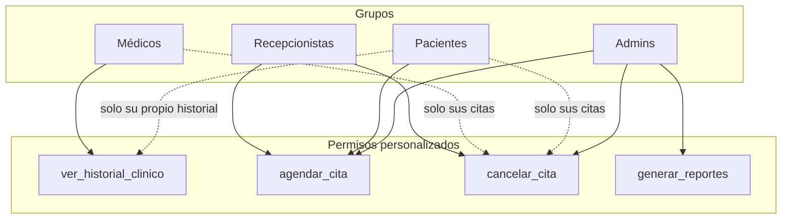

# Plataforma de Gestión de Consultas Médicas

Caso 2 de la Práctica Grupal de la Semana 12 de Desarrollo de Aplicaciones Web (IS093A), Universidad Nacional del Centro del Perú. La plataforma digitaliza el agendamiento de citas del Centro Médico Universitario, mantiene el historial clínico electrónico y controla el acceso a la información médica según el rol de cada usuario.

## Integrantes

| Integrante | Rama | Responsabilidades |
|---|---|---|
| Torres Ambrosio, Katherine Medally | `dev/integrante-1` | Modelos (Paciente, Médico, Cita, Consulta), formularios complejos, validaciones cruzadas, Django Admin con agenda y estadísticas, plantillas |
| Ramos Tacza, Camilda | `dev/integrante-2` | Settings, middleware de auditoría médica, middleware de horario y de alertas, login multi-rol, grupos, permisos y sesiones |


## Usuarios de prueba

Contraseña de todos: `Uncp2026!`. En el login se elige el tipo de usuario: si no coincide con el grupo, el acceso se rechaza y queda registrado.

| Usuario | Ingresar como | Notas |
|---|---|---|
| `director` | Administrador | Reportes, gestión del admin y logs de auditoría |
| `recepcion1` | Recepcionista | Agenda y cancela citas, registra pacientes |
| `lrojas`, `acastro`, `jsalazar`, `pmeza`, `rlopez`, `cflores`, `evega`, `mguzman` | Médico | Uno por especialidad y turno |
| `darana`, `vbendezu`, `kcardenas`, `ldavila`, `hespinoza` | Paciente | Los otros 10 pacientes no tienen cuenta (los atiende recepción) |

## Roles y permisos



| Permiso | Admins | Médicos | Recepcionistas | Pacientes |
|---|:-:|:-:|:-:|:-:|
| `ver_historial_clinico` | No | Sí | No | Solo el propio |
| `agendar_cita` | Sí | No | Sí | Sí (para sí mismo) |
| `cancelar_cita` | Sí | Solo sus citas | Sí | Solo sus citas |
| `generar_reportes` | Sí | No | No | No |
| Registrar consulta (`add_consulta`) | No | Solo sus citas | No | No |
| Registrar pacientes (`add_paciente`) | Sí | No | Sí | No |
| Logs de auditoría | Sí | No | No | No |

Las líneas punteadas son reglas de propiedad que no se resuelven con un permiso global: se implementan en `cuentas/permisos.py` (`puede_ver_historial`, `puede_cancelar_cita`). Por confidencialidad, ni siquiera el grupo Admins puede abrir un historial clínico.

## Requisitos funcionales implementados

| Requisito | Implementación |
|---|---|
| **RF1** Pacientes y médicos | `PacienteForm` y `MedicoForm`: DNI de 8 dígitos, CMP de 5 o 6 dígitos, fecha de nacimiento no futura, email `@uncp.edu.pe` obligatorio para estudiantes, horario de fin posterior al inicio |
| **RF2** Agendamiento | `CitaForm`: médicos filtrados por especialidad, slot ocupado (citas de 30 min), motivo de 20 caracteres como mínimo, un paciente no puede tener 2 citas el mismo día, el médico no puede tener citas superpuestas. `ConsultaForm`: diagnóstico, tratamiento, medicamentos, próxima cita y adjuntos simulados |
| **RF3** Autenticación | Login diferenciado por tipo de usuario, 4 grupos, permisos granulares y sesión de 20 minutos |
| **RF4** Middleware | Auditoría médica (quién abrió qué historial), validación de horario de atención, alerta de citas pendientes al médico y registro de accesos sensibles y denegados |
| **RF5** Admin | Agenda diaria (filtro "Hoy", por médico y especialidad), búsqueda por DNI o nombre, estadísticas, acción "Marcar citas como completadas", edad del paciente y días desde su última consulta |

## Middleware propio

| Middleware | Intercepta | Qué hace |
|---|---|---|
| `SesionInactivaMiddleware` | request | Cierra la sesión tras 20 minutos sin actividad |
| `AlertasCitasMiddleware` | request | En la primera petición de la sesión, avisa al médico cuántas citas pendientes tiene |
| `HorarioAtencionMiddleware` | request (antes de la vista) | Rechaza citas fuera de lunes a viernes de 8:00 a 18:00 y sábados de 8:00 a 13:00 |
| `AuditoriaMedicaMiddleware` | response | Registra cada acceso a un historial clínico y todo cambio (cita, cancelación, consulta, nota, paciente, cambios en el admin) |
| `AccesoNoAutorizadoMiddleware` | response y excepción | Registra cada 403 con su motivo y cada acceso sin sesión |

Todos los eventos se guardan en `RegistroAuditoria` (quién, cuándo, IP, acción y detalle), se muestran en la consola y se escriben en `logs/auditoria.log`.

```
[19/11/2026 10:32:28] INFO    usuario=rlopez alerta: 1 cita(s) hoy, 0 próximas
[19/11/2026 10:32:28] INFO    usuario=rlopez ip=127.0.0.1 accion="Acceso a historial clínico" ruta=/pacientes/2/historial/ paciente_id=2
[19/11/2026 10:32:04] WARNING usuario=darana ip=127.0.0.1 accion="Cita fuera de horario bloqueada" ruta=/citas/nueva/ fecha solicitada=22/11/2026 10:00
[19/11/2026 10:32:04] WARNING usuario=darana ip=127.0.0.1 accion="Acceso denegado (403)" ruta=/reportes/ No tiene permiso para generar reportes.
```

## Requisitos no funcionales

| Requisito | Cómo se cumple |
|---|---|
| Confidencialidad | Historial solo para médicos y el propio paciente; cada acceso queda auditado |
| Integridad | `Consulta.save()` impide modificar una consulta registrada; en el admin es de solo lectura; solo se pueden agregar notas |
| Disponibilidad | El middleware de horario solo permite agendar dentro del horario de atención |
| Trazabilidad | Cada cambio registra usuario, fecha/hora, IP, ruta y resultado |

## Seguridad y sesiones

| Medida | Configuración |
|---|---|
| CSRF | `` en todos los formularios POST; el logout solo acepta POST |
| Contraseñas | Hasheadas con PBKDF2-SHA256 y validadas |
| Cookie de sesión | `centromedico_sesion`: `HttpOnly`, `SameSite=Lax`, expira a los 20 minutos (`Max-Age=1200`) y se renueva con cada petición |
| SECRET_KEY | Se lee de `DJANGO_SECRET_KEY` o del archivo local `.secret_key` (ignorado por Git) |
| Sanitización | Textos libres sin `<script>`, `<style>` ni etiquetas HTML |
| Rendimiento | `select_related()` y `prefetch_related()` en listados e historial; estadísticas con `annotate()` |

## Estructura

```
├── config/          settings.py y urls.py
├── consultas/       modelos, formularios, vistas, admin, estadísticas, poblar_datos  (Integrante 1)
├── cuentas/         login multi-rol, permisos, señales, crear_roles                 (Integrante 2)
├── auditoria/       RegistroAuditoria, middleware y admin de logs                   (Integrante 2)
├── templates/       base.html, consultas/, admin/ (Integrante 1); registration/, 403.html (Integrante 2)
└── docs/capturas/   evidencias
```
