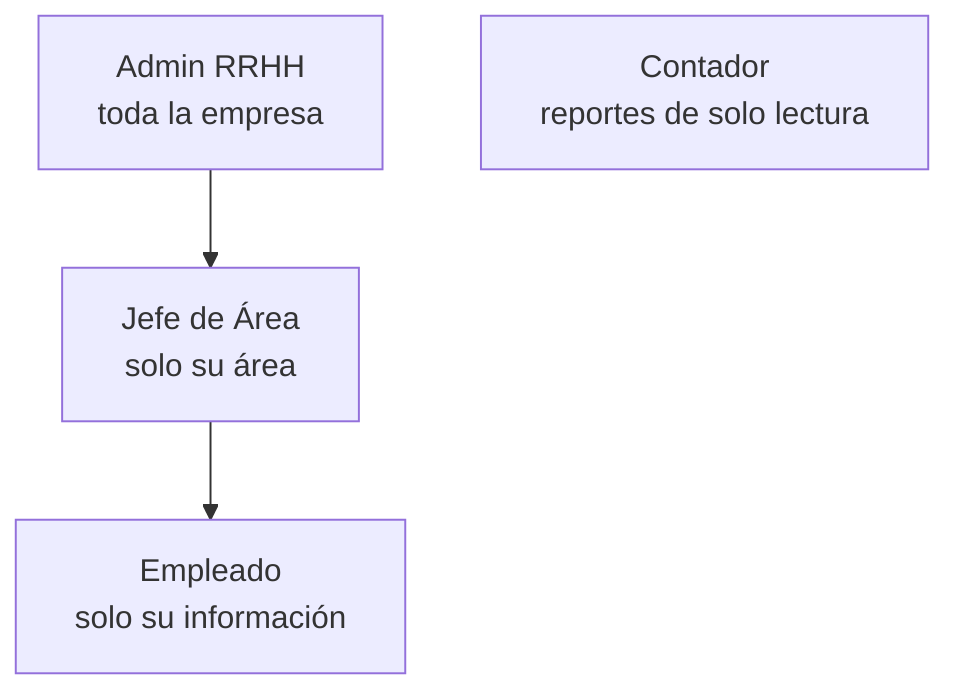

# Sistema de Control de Asistencia y Permisos: TecnoAndes S.A.C.

Caso 3 de la Práctica Grupal de la Semana 12 de Desarrollo de Aplicaciones Web (IS093A), Universidad Nacional del Centro del Perú. El sistema reemplaza las hojas de Excel de una empresa ficticia de 150 empleados: automatiza la marcación de asistencia, gestiona permisos y vacaciones con un flujo de aprobación y genera reportes para planilla, con control de acceso jerárquico.

## Integrantes

| Integrante | Rama | Responsabilidades |
|---|---|---|
| Torres Ambrosio, Katherine Medally | `dev/integrante-1` | Modelos (Empleado, Área, Asistencia, Permiso), formularios de asistencia y permisos, validaciones complejas, Django Admin con reportes, plantillas y manual de usuario |
| Ramos Tacza, Camilda | `dev/integrante-2` | Settings, middleware de auditoría, horario, recordatorio y bloqueo, login corporativo, roles jerárquicos, permisos y sesiones |

## Usuarios de prueba

Contraseña de todos: `Tecno2026!`. El login acepta el usuario o el correo `@tecnoandes.pe`.

| Usuario | Rol | Área | Para probar |
|---|---|---|---|
| `srios` | Admin RRHH | RRHH | Acceso total, corrección de asistencia, ver salarios, aprobar cualquier permiso, logs |
| `jvilca` | Jefe de Área | Sistemas | Aprueba solo a `aparedes` y `mtorres`; no puede aprobar sus propias vacaciones |
| `cramirez` | Jefe de Área | Ventas | Aprueba solo a `lhuaman` |
| `pyupanqui` | Jefe de Área | Logística | Aprueba solo a `fcanchari` |
| `rcondor` | Contador | Contabilidad | Reportes globales de solo lectura (sin ver salarios) |
| `aparedes`, `mtorres`, `lhuaman`, `ebaldeon`, `fcanchari` | Empleado | Varias | Marcar asistencia y solicitar permisos |
| `imucha` | Empleado desactivado | Sistemas | El login se rechaza (middleware y formulario de bloqueo) |

**Horario de marcación:** cada empleado tiene su horario (por ejemplo, `aparedes` de 9:00 a 17:00) y solo puede marcar 2 horas antes o después. Para probar fuera de ese rango, cambia el horario del empleado en el admin o pon `VALIDAR_HORARIO_MARCACION = False` en `config/settings.py`.

## Roles jerárquicos y permisos



| Permiso | Admin RRHH | Jefe de Área | Empleado | Contador |
|---|:-:|:-:|:-:|:-:|
| `registrar_asistencia` | Sí | Sí | Sí | Sí |
| `solicitar_permiso` | Sí | Sí | Sí | Sí |
| `aprobar_permiso` | Cualquiera (menos los propios) | Solo su equipo (menos los propios) | No | No |
| `ver_reportes_area` | Sí | Sí | No | No |
| `ver_reportes_globales` | Sí | No | No | Sí |
| `corregir_asistencia` | Sí | No | No | No |
| Ver salarios | Sí | No | No | No |
| Logs de auditoría | Sí | No | No | No |

En `cuentas/permisos.py`:

- **`permiso_requerido(...)`** exige los permisos de Django (con `cualquiera=True`, basta uno).
- **`filtrar_por_alcance(user, queryset)`** aplica la jerarquía a los datos: RRHH y el Contador ven toda la empresa, el jefe solo su área y el empleado solo lo suyo.
- **`puede_aprobar_permiso(user, permiso)`** define quién revisa cada solicitud.

## Requisitos funcionales implementados

| Requisito | Implementación |
|---|---|
| **RF1** Empleados y áreas | `EmpleadoForm`: DNI único de 8 dígitos, email `@tecnoandes.pe`, fecha de ingreso no futura, cargo obligatorio. Campo calculado: antigüedad en años y meses |
| **RF2** Asistencia | `MarcacionForm`: la hora la pone el servidor; no se permite una entrada con otra abierta; la salida debe ser posterior. Cálculo de horas y horas extra (más de 8). `CorreccionAsistenciaForm` (solo RRHH): justificación de 50 caracteres como mínimo, motivo, y guarda los valores anteriores |
| **RF3** Permisos | `PermisoForm`: tipo, fechas (fin igual o posterior al inicio), motivo de 30 caracteres como mínimo, adjunto simulado, sin superposición y con vacaciones disponibles suficientes. Flujo pendiente → aprobado/rechazado con notificación al empleado |
| **RF4** Autenticación jerárquica | Login corporativo, 4 roles, 6 permisos personalizados y sesión de 45 minutos |
| **RF5** Middleware | Recordatorio de asistencia, validación de horario de marcación (±2 h), auditoría de cambios y bloqueo de cuentas desactivadas |
| **RF6** Admin de RRHH | Asistencia diaria por área y fecha, permisos pendientes, horas extra por empleado, acción "Aprobar permisos seleccionados", vacaciones disponibles y exportación a texto |

## Middleware propio

| Middleware | Intercepta | Qué hace |
|---|---|---|
| `SesionInactivaMiddleware` | request | Cierra la sesión tras 45 minutos sin actividad |
| `BloqueoCuentaMiddleware` | request | Si un empleado es desactivado, cierra su sesión en la siguiente petición |
| `RecordatorioAsistenciaMiddleware` | request | Al iniciar sesión en día laborable sin marcación, muestra un recordatorio |
| `HorarioMarcacionMiddleware` | request (antes de la vista) | Rechaza marcaciones fuera de ±2 horas del horario del empleado |
| `AuditoriaMiddleware` | response | Registra marcaciones, correcciones, solicitudes, revisiones y cambios desde el admin |
| `AccesoNoAutorizadoMiddleware` | response y excepción | Registra cada 403 con su motivo y cada acceso sin sesión |

```
[19/11/2026 10:42:11] INFO    usuario=aparedes recordatorio: sin marcación de entrada hoy
[19/11/2026 10:42:12] WARNING usuario=aparedes ip=127.0.0.1 accion="Marcación de salida fuera de horario bloqueada" hora=10:42 permitido=16:00-20:00
[19/11/2026 10:42:12] WARNING usuario=jvilca ip=127.0.0.1 accion="Acceso denegado (403)" ruta=/permisos/10/revisar/ Solo el jefe del área del empleado o RRHH pueden revisar este permiso.
[19/11/2026 10:42:12] INFO    usuario=jvilca ip=127.0.0.1 accion="Revisión de permiso" ruta=/permisos/11/revisar/ decisión=aprobar
[19/11/2026 10:42:13] WARNING usuario=ebaldeon ip=127.0.0.1 accion="Acceso bloqueado: cuenta desactivada" ruta=/
```

## Requisitos no funcionales

| Requisito | Cómo se cumple |
|---|---|
| Integridad de datos | El empleado no puede completar un registro después de 24 horas; solo RRHH corrige, con justificación y conservando los valores anteriores |
| Confidencialidad | El salario se oculta en el admin a quien no sea RRHH; cada rol solo ve los datos de su alcance |
| Auditabilidad | Todo cambio registra usuario, fecha/hora, IP, ruta y resultado en `RegistroAuditoria` y en `logs/auditoria.log` |
| Usabilidad | Marcación con un solo botón y reloj en pantalla; manual en `docs/MANUAL_USUARIO.md` |

## Seguridad y sesiones

| Medida | Configuración |
|---|---|
| CSRF | `` en todos los formularios POST; el logout solo acepta POST |
| Contraseñas | Hasheadas con PBKDF2-SHA256 y validadas |
| Cookie de sesión | `tecnoandes_sesion`: `HttpOnly`, `SameSite=Lax`, `Max-Age=2700` (45 min) y se renueva con cada petición |
| SECRET_KEY | Se lee de `DJANGO_SECRET_KEY` o del archivo local `.secret_key` (ignorado por Git) |
| Sanitización | Motivos, justificaciones y comentarios sin `<script>` ni etiquetas HTML |
| Rendimiento | `select_related()` en listados y reportes; `prefetch_related()` para las horas extra del mes en el admin |

## Estructura

```
├── config/          settings.py y urls.py
├── rrhh/            modelos, formularios, vistas, admin, reportes, poblar_datos   (Integrante 1)
├── cuentas/         login corporativo, permisos jerárquicos, señales, crear_roles (Integrante 2)
├── auditoria/       RegistroAuditoria, middleware y admin de logs                 (Integrante 2)
├── templates/       base.html y rrhh/ (Integrante 1); registration/ y 403.html (Integrante 2)
└── docs/            MANUAL_USUARIO.md (Integrante 1) y capturas/
```

